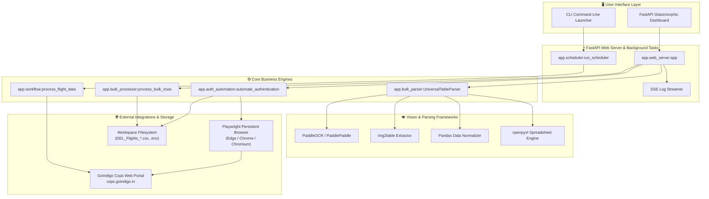
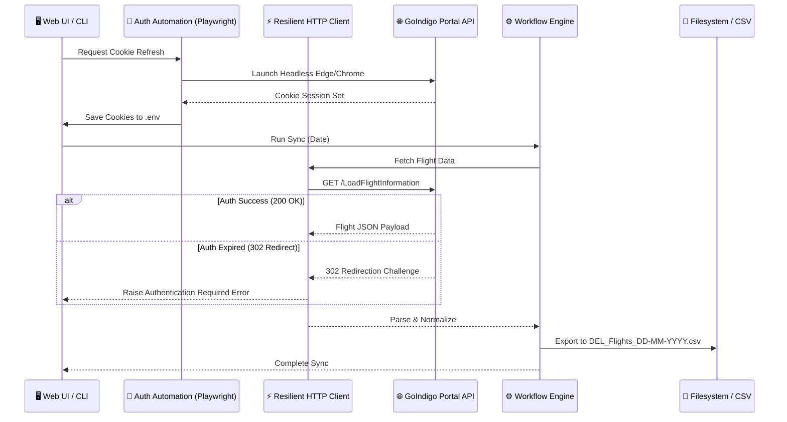

<div align="center">

<!-- ✈️ Animated Header -->


<!-- ⭐ Status Badges -->
<p>


</p>

<!-- 🔗 Tech Badges -->
<p>


</p>

<!-- 🚀 Quick Actions -->
<p>
<a href="#-quick-start"></a>
<a href="#-equipment-routing-logic-r2r4-swaps"></a>
<a href="#-universal-bulk-table-parser"></a>
</p>

<br/>

**✈️ Automated Flight Information Extraction • ⚡ Multi-Format Bulk MPOS Loader • 🛡️ Intelligent R2/R4 Equipment Routing**

</div>

<!-- 🌊 Animated Divider -->


---

## 📋 Table of Contents

- [✨ Features](#-features)
- [🏗️ Architecture](#️-architecture)
- [🛠️ Tech Stack](#️-tech-stack)
- [📁 Project Structure](#-project-structure)
- [🚀 Quick Start](#-quick-start)
- [📊 System Workflow](#-system-workflow)
- [📄 Universal Bulk Table Parser](#-universal-bulk-table-parser)
- [🔀 Equipment Routing Logic (R2/R4 Swaps)](#-equipment-routing-logic-r2r4-swaps)
- [⚡ Real-time Log Streaming (SSE)](#-real-time-log-streaming-sse)
- [🎨 Glassmorphism Design System](#-glassmorphism-design-system)
- [🧪 Automated Testing Suite](#-automated-testing-suite)
- [🔒 Security Hardening](#-security-hardening)
- [📄 License](#-license)

---

## ✨ Features

<table>
<tr>
<td width="50%">

### 🎯 Core Capabilities

| Feature | Description |
|---------|-------------|
| ✈️ **Flight Data Sync** | Automate schedule downloads from the official portal (`cops.goindigo.in`) |
| 📄 **Universal Bulk Parser** | Upload and parse Images (OCR), PDFs, Excel Spreadsheets (`.xlsx`, `.xls`), CSVs, and plain text pastes |
| 🔀 **Smart R2/R4 Routing** | Automatic swap resolution depending on the layout of physical aircraft equipment |
| ⚡ **Real-time Live Stream** | Stream server status and flight parsing logs directly using Server-Sent Events (SSE) |
| 📊 **CSV & Excel Export** | Export parsed flight data and allocation logs to standardized reports |

</td>
<td width="50%">

### 🛡️ Enterprise Resiliency

| Feature | Description |
|---------|-------------|
| 🔑 **Persistent Session Auth** | Playwright crawler automatically intercepts cookies and handles login challenges |
| 🔄 **Tenacity-Backed Client** | Exponential backoff retry policies for robust network operations |
| 🌊 **Thread-Safe Log Buffer** | Sliding window log buffer captures and delivers backend traces in real-time |
| 🧪 **Pytest Coverage** | Full test coverage for parser formats, cookie parsing, and workflow states |
| 📦 **Headless CLI Daemon** | Command-line background scheduler optimized for servers |

</td>
</tr>
</table>

---

## 🏗️ Architecture



---

## 🛠️ Tech Stack

<div align="center">

<!-- 🎨 Visual Icons Grid -->
<table>
<tr>
<td align="center" width="96">

<br><sub><b>Python 3.11</b></sub>
</td>
<td align="center" width="96">

<br><sub><b>FastAPI</b></sub>
</td>
<td align="center" width="96">

<br><sub><b>HTML5</b></sub>
</td>
<td align="center" width="96">

<br><sub><b>CSS3</b></sub>
</td>
<td align="center" width="96">

<br><sub><b>ES6 JS</b></sub>
</td>
<td align="center" width="96">

<br><sub><b>Git</b></sub>
</td>
</tr>
</table>

</div>

---

## 📁 Project Structure

<details open>
<summary><b>🗂️ Complete Directory Tree</b></summary>

```
GoIndigoAI/
├── 📂 app/                        # ⚡ Core backend modules
│   ├── 📝 __init__.py             #    └─ Module boundaries
│   ├── 🔑 auth.py                 #    └─ Header/cookie injection logic
│   ├── 🤖 auth_automation.py      #    └─ Playwright login crawler
│   ├── 📄 bulk_parser.py          #    └─ OCR/PDF/Excel spreadsheet parser
│   ├── ⚙️ bulk_processor.py       #    └─ SSE streaming processor & R2/R4 swap routing
│   ├── 🔧 config.py               #    └─ Pydantic settings manager (.env loader)
│   ├── 🚨 exceptions.py           #    └─ Central exception hierarchy
│   ├── 🌐 http_client.py          #    └─ HTTP Client (httpx) with exponential backoff
│   ├── 📊 logging_setup.py        #    └─ In-memory sliding log buffer
│   ├── 📦 models.py               #    └─ Pydantic validation models
│   ├── 🔍 parsers.py              #    └─ Flight response parser
│   ├── ⏰ scheduler.py            #    └─ CLI scheduler daemon
│   ├── 🛠️ utils.py                #    └─ Date/string normalizer functions
│   ├── 🛡️ web_server.py           #    └─ FastAPI router, endpoints & SSE routes
│   └── ✈️ workflow.py             #    └─ Automation workflow orchestrator
│
├── 📂 static/                     # 🎨 Frontend Web Console
│   ├── 📄 app.js                  #    └─ Live logging SSE logic
│   ├── 📄 bulk_upload.js          #    └─ Spreadsheet grid preview, upload & SSE stream
│   ├── 🎨 bulk_upload.css         #    └─ Glassmorphism dashboard styles
│   ├── 🎨 style.css               #    └─ Global style variables
│   ├── 🖼️ current_modal_state*.png#    └─ UI state screenshots
│   └── 🌐 index.html              #    └─ Dashboard HTML page
│
├── 📂 tests/                      # 🧪 Pytest test suite
│   ├── 📝 __init__.py             #    └─ Test suite boundary
│   ├── 🧪 test_auth_harden.py     #    └─ Auth cookie validation tests
│   ├── 🧪 test_parsers.py         #    └─ Parser unit tests (CSV, PDF, OCR tables)
│   └── 🧪 test_workflow.py        #    └─ Main orchestrator test
│
├── 📄 main.py                     # 🚀 Root entry point (CLI & Web server launcher)
├── 📄 requirements.txt            # 📦 Third-party python dependencies
├── 📄 .env.example                # 🔒 Environment variable template
└── 📄 .gitignore                  # ⚙️ Git ignored files
```

</details>

---

## 🚀 Quick Start

### 1️⃣ Prepare Environment
Ensure you have **Python 3.11+** installed. Setup a virtual environment and install packages:
```bash
# Setup virtual environment
python -m venv venv

# Activate virtual environment
# Windows:
.\venv\Scripts\activate
# Linux/macOS:
source venv/bin/activate

# Install dependencies
pip install -r requirements.txt
```

### 2️⃣ Download Browser Drivers
Playwright requires browser binaries to automate login session creation:
```bash
playwright install chromium
```

### 3️⃣ Setup Environment Secrets
Copy `.env.example` to `.env` and fill in details:
```bash
cp .env.example .env
```

### 4️⃣ Start Web Server Dashboard
Start the local web dashboard:
```bash
python main.py
```
Open **`http://127.0.0.1:8000`** in your browser.

---

## 📊 System Workflow



---

## 📄 Universal Bulk Table Parser

The universal parser in `app/bulk_parser.py` extracts tabular layout configurations from unstructured uploads:

- **Spreadsheets (`.xlsx`, `.xls`, `.csv`)**: Parsed natively via **Pandas** and **openpyxl**.
- **Images (`.png`, `.jpg`, `.webp`) & PDFs**: OCR layout detection driven by **img2table** and **PaddleOCR**.
- **Text / Markdown Pates**: Cleans and parses space-separated plain text formats.

### Normalization Logic
Cell contents are standardized using rules:
- `None` or unclear symbols (e.g. `○`, `◯`, `⊙`, `●`, `–`, `?`, `N/A`) -> `None` (marks the position as **unclear/skip**).
- Double-spacing or extra spaces -> trimmed and stripped.
- Valid 4-6 digit numeric values -> mapped to device asset numbers (`RETXXXXX`).

---

## 🔀 Equipment Routing Logic (R2/R4 Swaps)

Certain aircraft layouts have physical limitations where specific device locations are missing. To prevent sync failure, `app/bulk_processor.py` implements **R2/R4 Equipment Swap Logic**:

```text
       Target Allocation (User Uploaded Row)
                       │
             ┌─────────┴─────────┐
             ▼                   ▼
          Target R2           Target R4
             │                   │
   Is R2 Physical Slot   Is R4 Physical Slot
     NOT Available?      NOT Available?
             │                   │
             ├─────────YES───────┼─────────YES───────┐
             │                   │                   │
             ▼                   ▼                   ▼
    Redirect target R2  Redirect target R4      No Swap Needed
    allocation to R4    allocation to R2        Keep original
```

### Business Rule Implementation
```python
# Swap logic implementation detail from app/bulk_processor.py:
if r2_given != r4_given:
    r2_phys = "R2" in available_physical_positions
    r4_phys = "R4" in available_physical_positions
    
    if r2_given and not r2_phys and r4_phys:
        positions["R4"] = r2_target
        positions["R2"] = ""  # Clear R2
        
    elif r4_given and not r4_phys and r2_phys:
        positions["R2"] = r4_target
        positions["R4"] = ""  # Clear R4
```

---

## ⚡ Real-time Log Streaming (SSE)

Real-time tracing allows system administrators to monitor parsing, token updates, and routing adjustments live.

- **Thread-safe Buffer**: `LogBufferHandler` acts as a thread-safe deque that captures logs globally.
- **Server-Sent Events (SSE)**: The `/api/logs/stream` endpoint continuously flushes logs using `EventSource` web sockets:

```javascript
// Web UI subscription client code (static/app.js)
const eventSource = new EventSource("/api/logs/stream");
eventSource.onmessage = (event) => {
    const logsContainer = document.getElementById("logs-container");
    logsContainer.innerText += event.data + "\n";
    logsContainer.scrollTop = logsContainer.scrollHeight;
};
```

---

## 🎨 Glassmorphism Design System

The frontend web console provides an executive-level visual experience utilizing modern web guidelines:

<table>
<tr>
<td>

### 🎨 Indigo Theme Palette

| Color | Hex | Usage |
|-------|-----|-------|
| 🔵 **Deep Indigo** | `#0A1172` | Main branding |
| 🪟 **Frosted Glass** | `rgba(255,255,255,0.06)` | Containers |
| 🪐 **Dark Abyss** | `#080B10` | Page background |
| 🟢 **Neon Lime** | `#C6FF00` | Accent badges |

</td>
<td>

### ✨ Visual Effects

- 🌫️ **Frosted Glass Effects** - High backdrop blur on panels.
- 🌀 **Ambient Back-Glows** - Subtle radial gradient overlays.
- 🔮 **Micro-animations** - Hover transitions on inputs and action buttons.
- 📱 **Responsive Grid** - Mobile and desktop adaptive flex layout.

</td>
</tr>
</table>

---

## 🧪 Automated Testing Suite

Validate components by executing:
```bash
pytest tests/
```

### Test Suites Included:
- **`test_auth_harden.py`**: Validates dynamic cookie extraction, token updates, and fallback header validation.
- **`test_parsers.py`**: Ensures multi-format parser handles image tables (OCR), PDF exports, Excel datasets, and character encoding issues.
- **`test_workflow.py`**: Runs end-to-end processing verification for flight synchronization tasks.

---

## 🔒 Security Hardening

- 🚯 **Zero Credentials Committed**: The `.gitignore` excludes local `.env` and browser caches. A template `.env.example` is provided for config mapping.
- 🍪 **HTTP-only Cookie Preservation**: Session cookies intercepted by Playwright are locked in local configurations rather than exposed over insecure scripts.
- 🛑 **Dry Run Mode**: Safe testing mode (`DRY_RUN=True`) logs target allocations without writing data back to the live Indigo endpoint.

---

## 📄 License

<div align="center">

<!-- 🌊 Footer Wave -->


<br/>

**Internal Use Software** • GoIndigo Flight Operations

<br/>

Built with 💚 for GoIndigo Automation Tasks

</div>
